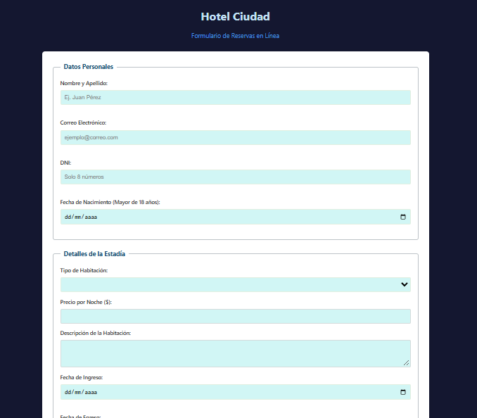

# Hotel Ciudad — Sistema de Reservas

Formulario de reservas online para un hotel, con validaciones en tiempo real y cálculo dinámico del total.

**Demo en vivo:** https://msol1979.github.io/hotel-ciudad/



## Sobre el proyecto

Examen Parcial II de **Programación III** — Tecnicatura Superior en Desarrollo de Software, ITSE (Instituto Tecnológico Santiago del Estero), 2026.

## Funcionalidades

- Carga de las habitaciones desde una estructura **JSON**.
- Al elegir el tipo de habitación, el **precio y la descripción se completan solos**.
- **Validaciones en tiempo real** con mensajes debajo de cada campo y colores de error/éxito:
  - Nombre y apellido.
  - Correo electrónico.
  - DNI de 8 dígitos.
  - Huésped mayor de 18 años.
  - Fechas de ingreso y egreso coherentes.
  - Cantidad de huéspedes entre 1 y 6.
  - Tarjeta de 16 dígitos, CVV de 3 o 4 dígitos y vencimiento futuro.
- Botón **"Confirmar Reserva" bloqueado** hasta que todo sea válido, con un aviso del primer error detectado.

### Extras

- **Total a pagar** que se actualiza al cambiar noches o habitación.
- **Seguro adicional** opcional (+15 %).
- **Resumen de la reserva** antes de confirmar.
- **Detección automática de la tarjeta** (Visa / MasterCard).

## Tecnologías

HTML5 · CSS3 · JavaScript (manipulación del DOM y eventos)

## Estructura

```
hotel-ciudad/
├── index.html
├── css/
│   └── styles.css
├── js/
│   └── reservas.js
├── json/
│   └── habitaciones.json
└── recursos_adicionales/
    ├── logo-visa.png
    └── tarjeta-mastercard.png
```

## Autora

**María Sol Martínez** — [github.com/msol1979](https://github.com/msol1979)
